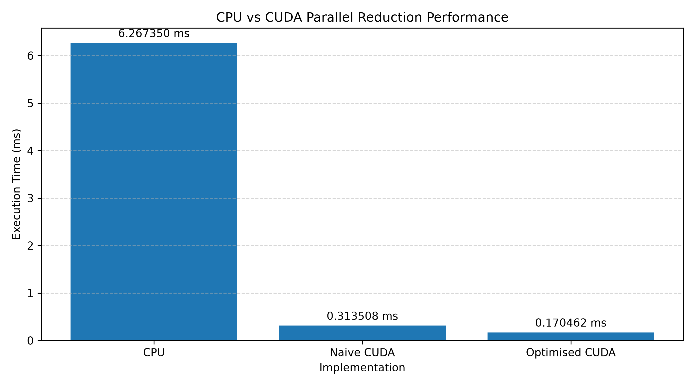
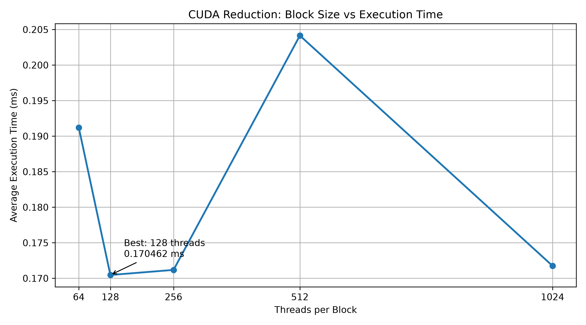
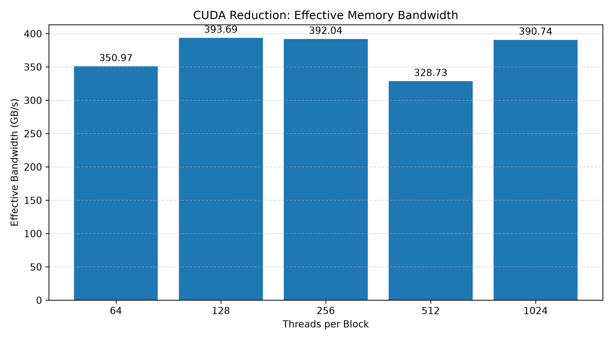
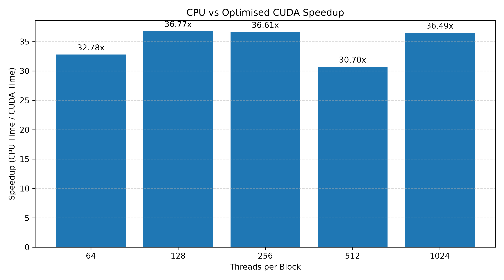

<div align="center">

# CUDA Parallel Reduction

### Design, Implementation and Performance Evaluation of Parallel Summation on an NVIDIA GPU

**Parallel Computing Laboratory Evaluation Project**

[](https://developer.nvidia.com/cuda-toolkit)
[](https://ubuntu.com/)
[](https://developer.nvidia.com/cuda-toolkit)

</div>

---

## Table of Contents

1. [Introduction](#1-introduction)
2. [Problem Statement](#2-problem-statement)
3. [Project Objectives](#3-project-objectives)
4. [Background: Parallel Reduction](#4-background-parallel-reduction)
5. [System Configuration](#5-system-configuration)
6. [Input Dataset](#6-input-dataset)
7. [Implementation Approaches](#7-implementation-approaches)
8. [Project Architecture and Workflow](#8-project-architecture-and-workflow)
9. [Repository Structure](#9-repository-structure)
10. [Build and Execution Instructions](#10-build-and-execution-instructions)
11. [Experimental Methodology](#11-experimental-methodology)
12. [Performance Results](#12-performance-results)
13. [Graphical Analysis](#13-graphical-analysis)
14. [Correctness Validation](#14-correctness-validation)
15. [Key Observations](#15-key-observations)
16. [Applications](#16-applications)
17. [Limitations and Scope](#17-limitations-and-scope)
18. [Conclusion](#18-conclusion)
19. [References](#19-references)

---

## 1. Introduction

Parallel computing improves the execution of computationally intensive tasks by distributing work across multiple processing elements. Graphics Processing Units (GPUs) are particularly effective for workloads that contain a large number of independent operations.

This project implements **parallel reduction**, a fundamental parallel computing operation used to combine the elements of an array into a single result. The operation evaluated in this project is the summation of a large array of floating-point values.

Three approaches are implemented and evaluated:

- **CPU Reduction:** sequential summation using C++.
- **Naive CUDA Reduction:** GPU-based reduction using shared memory, interleaved addressing and thread synchronisation.
- **Optimised CUDA Reduction:** GPU-based reduction using multiple input elements per thread and warp shuffle instructions.

The implementations are compared using execution time, block-size experiments and numerical correctness. The purpose is to understand how parallel reduction strategies and CUDA execution configuration influence performance.

## 2. Problem Statement

Summing a large array sequentially requires the processor to process the elements one after another. As the input size increases, the time required for this operation can become significant.

The problem addressed in this project is:

> **To design, implement and evaluate CUDA-based parallel reduction techniques for summing a large array of floating-point values, and compare their performance and correctness against a sequential CPU implementation.**

The project also investigates how changing the number of threads per CUDA block affects execution time and effective memory bandwidth.

## 3. Project Objectives

1. Implement sequential array summation using C++.
2. Develop a baseline CUDA reduction kernel using shared memory.
3. Develop an optimised CUDA reduction kernel using warp-level shuffle operations.
4. Evaluate the effect of different CUDA block sizes.
5. Measure execution time using CUDA events for GPU implementations.
6. Compare CPU and GPU execution times.
7. Validate GPU output against a CPU reference result using a defined absolute error tolerance.
8. Present experimental observations through result tables and graphs.

## 4. Background: Parallel Reduction

### 4.1 What is Reduction?

Reduction is an operation that combines multiple input values to produce one output value. Common examples include sum, minimum, maximum and product.

For an input array:

\[
A = [a_0, a_1, \ldots, a_{N-1}]
\]

the sum reduction is:

\[
S = \sum_{i=0}^{N-1} a_i
\]

A sequential implementation performs the additions in a loop. A parallel implementation divides the input among multiple threads. Each thread or group of threads computes a partial sum, and those partial sums are combined to produce the final result.

### 4.2 Sequential Reduction

In sequential reduction, one CPU execution flow visits every array element and updates an accumulator.

**Characteristics:**
- Straightforward implementation.
- One sequential accumulation loop.
- No GPU thread coordination.
- Execution time is dependent on the CPU and memory subsystem.

### 4.3 Parallel Reduction

In parallel reduction, multiple GPU threads process different portions of the input concurrently. Threads calculate partial sums, combine values within a warp or block, and contribute block-level results to the final output.

**Characteristics:**
- Work is distributed across many GPU threads.
- Synchronisation is required when threads share intermediate values.
- Reduction strategy and launch configuration influence performance.
- Floating-point addition order can differ from sequential execution, causing small rounding differences.

## 5. System Configuration

The following configuration was used for the recorded experiment.

| Component | Configuration |
|---|---|
| GPU | NVIDIA RTX 4500 Ada Generation |
| GPU memory | 24,570 MiB |
| CUDA Toolkit | 13.5 |
| Operating environment | Ubuntu on WSL2 |
| Programming languages | C++ and CUDA C++ |
| CPU compiler | g++ |
| CUDA compiler | nvcc |
| Plotting/data tools | Python, Pandas, Matplotlib |

**Note:** The recorded measurements are specific to this hardware and software environment. Results may differ on other systems.

## 6. Input Dataset

All implementations use the same generated input values to make the comparison consistent.

| Parameter | Value |
|---|---:|
| Number of elements | \(2^{24}\) |
| Total elements | 16,777,216 |
| Data type | 32-bit floating point (`float`) |
| Input size | 64 MiB |
| Value generation | `((i % 100) + 1) / 100.0f` |

The input values repeat a sequence of 100 fractional values. The CPU and CUDA implementations use the same generation formula.

The CPU implementation accumulates the values using a `double` variable to obtain the reference sum. CUDA implementations accumulate in `float`.

## 7. Implementation Approaches

### 7.1 CPU Sequential Reduction

**Source file:** `src/cpu_reduction.cpp`

The CPU program:
1. Allocates an array containing \(2^{24}\) floating-point elements.
2. Generates the input values.
3. Initialises a double-precision accumulator to zero.
4. Iterates through the array and adds each element to the accumulator.
5. Measures the loop execution time using C++ high-resolution clock utilities.
6. Prints the reference sum and execution time.

This implementation acts as the sequential baseline and provides the reference value for validation.

### 7.2 Naive CUDA Reduction

**Source file:** `src/naive_reduction.cu`

The naive implementation uses a shared-memory reduction approach.

**Execution steps:**
1. The input array is copied from host memory to GPU memory.
2. The input is divided into blocks of 256 threads.
3. Each thread loads one input element into shared memory. Out-of-range threads load zero.
4. Threads synchronise to ensure that shared-memory values are ready.
5. An interleaved addressing reduction is performed. At each stage, selected threads add values from other positions in shared memory.
6. Synchronisation is performed between reduction stages.
7. Thread 0 of each block adds that block's partial sum to the global output using `atomicAdd`.

**Important CUDA concepts used:**
- `__shared__` memory for block-level intermediate values.
- `__syncthreads()` for block-wide synchronisation.
- `atomicAdd()` to safely update the shared global output.

### 7.3 Optimised CUDA Reduction

**Source file:** `src/optimized_reduction.cu`

The optimised implementation reduces synchronisation and shared-memory work by using warp-level operations.

**Execution steps:**
1. Each thread loads up to two input elements and adds them locally.
2. Threads within a warp perform reduction using `__shfl_down_sync`.
3. One partial sum per warp is written to shared memory.
4. The first warp combines the warp-level partial sums.
5. Thread 0 adds the block-level result to the global output using `atomicAdd`.

**Optimisation techniques:**

| Technique | Purpose |
|---|---|
| Multiple elements per thread | Performs an initial addition during loading and reduces the number of participating threads required for the input |
| Warp shuffle (`__shfl_down_sync`) | Exchanges values between lanes in a warp without using shared memory for every reduction stage |
| Shared memory for warp partial sums | Combines the results produced by individual warps |
| Atomic addition | Accumulates each block's partial result into the final output |

The block size is configurable at compile time through the `BLOCK_SIZE` macro. The experiment evaluates 64, 128, 256, 512 and 1024 threads per block.

## 8. Project Architecture and Workflow

The experiment follows the workflow below:

```text
                 Input Array (2^24 float values)
                              |
              +---------------+---------------+
              |               |               |
              v               v               v
        CPU Reduction    Naive CUDA      Optimised CUDA
        Sequential       Reduction       Reduction
        C++ Loop         Shared Memory   Warp Shuffle
              |               |               |
              v               v               v
         CPU Reference    GPU Partial     GPU Partial
             Sum             Sums             Sums
                              |               |
                              v               v
                       Atomic Addition  Atomic Addition
                              |               |
                              v               v
                         GPU Result      GPU Result
                              |               |
                              +-------+-------+
                                      |
                                      v
                           Correctness Validation
                                      |
                                      v
                           Performance Comparison
                                      |
                                      v
                         Tables, Graphs and Analysis
```

The CPU implementation provides the reference sum. Both CUDA implementations produce GPU results that are checked against this reference.

## 9. Repository Structure

```text
cuda-parallel-reduction/
│
├── README.md
│
├── docs/
│   └── experiment_summary.md
│
├── graphs/
│   ├── bandwidth_comparison.png
│   ├── block_size_comparison.png
│   ├── cpu_vs_cuda.png
│   └── speedup_comparison.png
│
├── results/
│   ├── block_size_results.csv
│   ├── final_results.csv
│   └── validation_report.txt
│
├── src/
│   ├── cpu_reduction.cpp
│   ├── naive_reduction.cu
│   └── optimized_reduction.cu
│
├── test_cuda.cu
└── .gitignore
```

### Directory Description

| Directory/File | Description |
|---|---|
| `src/` | Contains the CPU, naive CUDA and optimised CUDA implementations |
| `results/` | Stores measured performance data and the validation report |
| `graphs/` | Contains graphs generated from the recorded experiment results |
| `docs/` | Contains the experiment summary |
| `test_cuda.cu` | A small CUDA program used to check basic GPU kernel execution |
| `README.md` | Project documentation |

## 10. Build and Execution Instructions

### 10.1 Prerequisites

Ensure that the environment has:
- A CUDA-capable NVIDIA GPU.
- NVIDIA driver compatible with the installed CUDA Toolkit.
- CUDA Toolkit with `nvcc`.
- A C++ compiler such as `g++`.
- Ubuntu or another supported Linux environment.

Verify the installation:

```bash
nvidia-smi
nvcc --version
g++ --version
```

### 10.2 Clone the Repository

```bash
git clone <repository-url>
cd cuda-parallel-reduction
```

Replace `<repository-url>` with the URL of the Git repository.

### 10.3 Create a Binary Directory

```bash
mkdir -p bin
```

### 10.4 Compile and Run the CPU Implementation

```bash
g++ -O2 -std=c++17 src/cpu_reduction.cpp -o bin/cpu_reduction
./bin/cpu_reduction
```

### 10.5 Compile and Run the Naive CUDA Implementation

```bash
nvcc -O2 src/naive_reduction.cu -o bin/naive_reduction
./bin/naive_reduction
```

The naive implementation uses a fixed block size of 256 threads.

### 10.6 Compile and Run the Optimised CUDA Implementation

The following command compiles the optimised kernel with 128 threads per block:

```bash
nvcc -O2 -DBLOCK_SIZE=128 src/optimized_reduction.cu -o bin/optimized_128
./bin/optimized_128
```

To evaluate other block sizes, change the compile-time value:

```bash
nvcc -O2 -DBLOCK_SIZE=64 src/optimized_reduction.cu -o bin/optimized_64
nvcc -O2 -DBLOCK_SIZE=256 src/optimized_reduction.cu -o bin/optimized_256
nvcc -O2 -DBLOCK_SIZE=512 src/optimized_reduction.cu -o bin/optimized_512
nvcc -O2 -DBLOCK_SIZE=1024 src/optimized_reduction.cu -o bin/optimized_1024
```

Run each executable to obtain its output.

### 10.7 Run the Basic CUDA Test

```bash
nvcc test_cuda.cu -o bin/test_cuda
./bin/test_cuda
```

This test launches a simple GPU kernel and prints a message from five GPU threads. It checks basic CUDA execution; it is not a performance benchmark.

## 11. Experimental Methodology

The following methodology was used for the recorded CUDA measurements.

| Parameter | Setting |
|---|---:|
| Warm-up iterations | 5 |
| Measured iterations | 30 |
| GPU timing mechanism | CUDA events |
| Input transfer | Host-to-device transfer excluded |
| Output reset | `cudaMemset` included in the measured GPU interval |
| GPU result retrieval | Device-to-host copy performed after timed iterations |

The average GPU execution time is calculated as:

\[
T_{\text{avg}} = \frac{T_{\text{total}}}{30}
\]

The recorded GPU interval includes resetting the output value before each kernel launch. It excludes host-to-device input transfer and the final device-to-host result copy.

The CPU timing measures the sequential summation loop. Therefore, the CPU-to-GPU timing ratio is a comparison of the CPU loop time with the measured CUDA interval, not an end-to-end application speedup including data transfers.

## 12. Performance Results

### 12.1 CPU, Naive CUDA and Optimised CUDA

| Implementation | Threads per Block | Blocks | Average Time (ms) | Result Sum |
|---|---:|---:|---:|---:|
| CPU | — | — | 6.267350 | 8472487.359375 |
| Naive CUDA | 256 | 65536 | 0.313508 | 8472488 |
| Optimised CUDA | 64 | 131072 | 0.191210 | 8472487 |
| Optimised CUDA | 128 | 65536 | **0.170462** | 8472489 |
| Optimised CUDA | 256 | 32768 | 0.171179 | 8472487 |
| Optimised CUDA | 512 | 16384 | 0.204147 | 8472487 |
| Optimised CUDA | 1024 | 8192 | 0.171749 | 8472485 |

<sub>Source: `results/final_results.csv`</sub>

### 12.2 Block-Size Experiment

The optimised CUDA implementation was evaluated with five block sizes.

| Block Size | Number of Blocks | Average Time (ms) |
|---:|---:|---:|
| 64 | 131072 | 0.191210 |
| 128 | 65536 | **0.170462** |
| 256 | 32768 | 0.171179 |
| 512 | 16384 | 0.204147 |
| 1024 | 8192 | 0.171749 |

The lowest measured execution time was obtained with **128 threads per block**, at **0.170462 ms**.

### 12.3 Performance Ratios

Using the recorded average times:

- Naive-to-optimised improvement: \(0.313508 / 0.170462 \approx 1.84\times\).
- CPU-to-optimised timing ratio: \(6.267350 / 0.170462 \approx 36.77\times\).

These ratios compare the recorded timings under the methodology described in Section 11. The CPU-to-GPU ratio excludes host-device transfers and should not be interpreted as end-to-end application speedup.

## 13. Graphical Analysis

The following figures are included in the repository under `graphs/`.

### 13.1 CPU vs CUDA Execution Time

This graph compares the CPU sequential implementation, naive CUDA implementation and the best-performing optimised CUDA configuration.



**Observation:** The recorded CPU loop time is 6.267350 ms. The naive CUDA time is 0.313508 ms, while the optimised 128-thread configuration records 0.170462 ms.

### 13.2 Effect of Block Size on Execution Time



**Observation:** The 128-thread configuration records the lowest average execution time among the tested block sizes. The 512-thread configuration is slower in this experiment, showing that increasing the block size does not necessarily improve performance.

### 13.3 Effective Memory Bandwidth



**Observation:** The graph compares the estimated effective bandwidth across the five optimised configurations. The 128-thread configuration records approximately 393.69 GB/s.

The bandwidth values are estimates based on the experiment's input size and measured execution time. They are not a direct measurement of total system memory traffic.

### 13.4 CPU-to-CUDA Timing Ratio



**Observation:** The 128-thread configuration has the highest CPU-to-CUDA timing ratio in the recorded graph, approximately 36.77x. This is a kernel-interval comparison and excludes host-device data transfers.

## 14. Correctness Validation

The GPU results are validated against the CPU reference sum.

| Validation Parameter | Value |
|---|---:|
| CPU reference sum | 8472487.359375 |
| Allowed absolute error | 5.0 |
| Validation condition | Absolute error ≤ 5.0 |

The absolute error is calculated as:

\[
E_{\text{abs}} = |S_{\text{CPU}} - S_{\text{GPU}}|
\]

### Validation Report

| CUDA Configuration | GPU Sum | Absolute Error | Status |
|---|---:|---:|---|
| Naive CUDA | 8472488 | 0.640625 | PASS |
| Optimised CUDA – 64 | 8472487 | 0.359375 | PASS |
| Optimised CUDA – 128 | 8472489 | 1.640625 | PASS |
| Optimised CUDA – 256 | 8472487 | 0.359375 | PASS |
| Optimised CUDA – 512 | 8472487 | 0.359375 | PASS |
| Optimised CUDA – 1024 | 8472485 | 2.359375 | PASS |

<sub>Source: `results/validation_report.txt`</sub>

**Result:** All six CUDA configurations satisfy the specified absolute error tolerance of 5.0.

Small differences between CPU and GPU sums are expected because floating-point addition is not associative. Parallel execution can combine values in a different order from sequential CPU accumulation.

## 15. Key Observations

1. **GPU parallelism reduces the measured computation time:** Both CUDA implementations complete the reduction in less time than the CPU sequential loop in the recorded experiment.
2. **The optimised kernel outperforms the naive kernel:** The best optimised configuration records 0.170462 ms compared with 0.313508 ms for naive CUDA, an approximately 1.84x timing ratio.
3. **Block size influences performance:** Among the tested configurations, 128 threads per block gives the lowest measured average time.
4. **A larger block size is not automatically faster:** The 512-thread configuration records the highest execution time among the optimised configurations tested.
5. **All CUDA outputs pass validation:** Every measured GPU result remains within the specified absolute error tolerance.
6. **Timing scope matters:** The GPU measurements exclude input transfer time, so they represent the measured CUDA interval rather than complete application execution time.

## 16. Applications

Parallel reduction is a building block in several computational workloads:

- **Machine learning:** Summation of loss values, gradient-related calculations and aggregation of tensor elements.
- **Scientific computing:** Aggregating simulation data and numerical measurements.
- **Statistics:** Computing sums used in averages, variance and other statistical operations.
- **Computer vision and image processing:** Aggregating pixel or feature values.
- **Numerical computing:** Vector operations, norms and other array-based calculations.

## 17. Limitations and Scope

- The experiment evaluates array summation; it does not benchmark every type of reduction operation.
- Performance measurements are specific to the recorded GPU, driver, CUDA Toolkit and execution environment.
- Host-to-device and device-to-host transfer times are excluded from the reported GPU timing.
- The CPU and GPU use different accumulation precision (`double` for the CPU reference and `float` for CUDA), so a tolerance-based comparison is used.
- The recorded experiment uses one input size. Performance trends may change with different input sizes.
- The reported effective bandwidth is an estimate derived from the experiment's input size and execution time.

## 18. Conclusion

This project implemented and evaluated three approaches to array summation: sequential CPU reduction, naive CUDA reduction and optimised CUDA reduction.

The naive CUDA implementation demonstrated the use of shared memory, interleaved addressing, thread synchronisation and atomic addition. The optimised implementation used multiple elements per thread, warp shuffle operations and shared memory to combine warp-level partial sums.

For the tested input of 16,777,216 floating-point elements, the best recorded configuration was the optimised CUDA implementation with 128 threads per block. It achieved an average measured time of **0.170462 ms**, compared with **0.313508 ms** for the naive CUDA implementation. All six CUDA configurations passed correctness validation with an absolute error of at most 5.0.

The experiment demonstrates that parallel reduction can significantly reduce the measured computation time for large array summation workloads. It also shows that optimisation techniques and block-size selection influence GPU performance, and that correctness must be checked alongside execution speed.

## 19. References

1. NVIDIA, [CUDA C++ Programming Guide](https://docs.nvidia.com/cuda/cuda-c-programming-guide/).
2. NVIDIA, [CUDA Toolkit Documentation](https://docs.nvidia.com/cuda/).
3. NVIDIA, [CUDA C++ Best Practices Guide](https://docs.nvidia.com/cuda/cuda-c-best-practices-guide/).
4. Project source implementations and recorded experiment outputs in this repository.

---

<div align="center">

**CUDA Parallel Reduction — Parallel Computing Laboratory Evaluation**

*Implementation • Experimentation • Validation • Performance Analysis*

</div>
